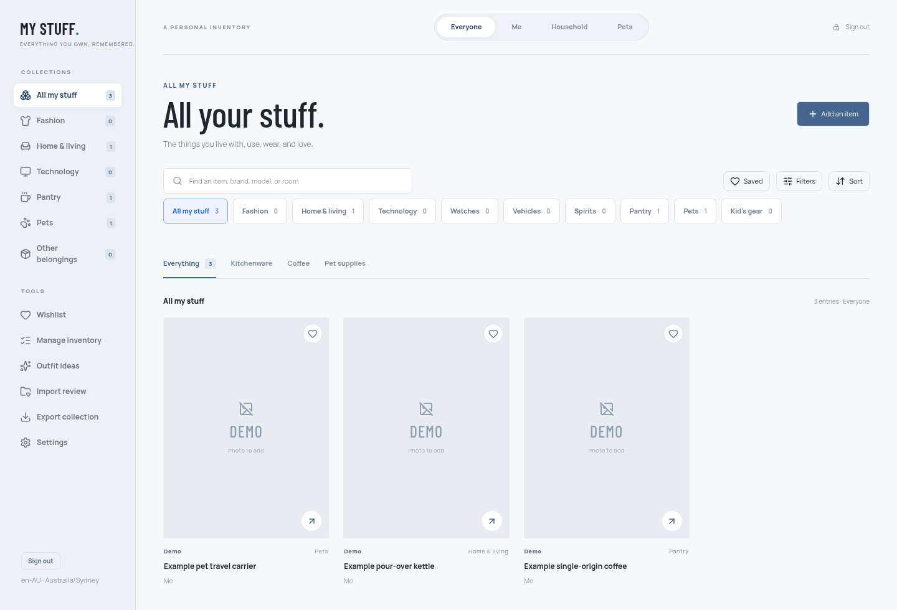

# My Stuff

My Stuff is a private, self-hosted inventory for the things a household owns: clothes, home goods, technology, pantry discoveries, pet supplies, vehicles, watches, and anything else worth remembering. It keeps photos, notes, purchase details, groups, wishlists, and optional public sale listings in one place.



## Start in five minutes

You need Docker with Compose.

```sh
mkdir my-stuff && cd my-stuff
curl -O https://raw.githubusercontent.com/johnnybravo-xyz/mystuff/main/compose.yaml
docker compose up -d
docker compose logs app
```

Open the one-time `/setup?token=…` URL printed in the log. The wizard creates the administrator, regional settings, household profiles, collections, and optional features. You do not need to create a password or session secret in an environment file first.

The container listens on `127.0.0.1:3000`. Put it behind HTTPS before exposing it outside a trusted LAN. See [installation](docs/install.md), [first run](docs/first-run.md), and [reverse proxy](docs/reverse-proxy.md).

## Data and backup

All persistent state lives in the `mystuff-data` volume mounted at `/data`: SQLite records, photos, the generated session key, and bounded pre-migration snapshots. One application container must own that volume.

```sh
docker compose exec app mystuff backup /data/backups/my-stuff.tar.gz
docker compose exec app mystuff restore --verify /data/backups/my-stuff.tar.gz
```

A backup contains a consistent SQLite copy, the matching image tree, and a checksum manifest. It excludes passwords in raw form, setup tokens, and the session-signing key. Read [backup and restore](docs/backup-restore.md) before disaster recovery or replacement restores.

## Main features

- Configurable household profiles with stable IDs and an explicit Unassigned state.
- Fashion, Home, Technology, Watches, Vehicles, Spirits, Pantry, Pets, Kids, and Other collections.
- Manual entry, private photo uploads, and guarded product URL imports.
- Groups, Wishlist, Trash and restore, readable Markdown/HTML exports, and optional outfit ideas.
- Pantry purchase details and editable tasting notes.
- Optional public shop with selected photos, buyer comments, persistent rate limits, and immediate withdrawal.
- Built-in Argon2id login, database sessions, persistent login throttling, CSRF checks, and local password recovery.
- Portable backup/export, verified restore, image garbage reporting, health checks, and ordered migrations.

## Supported deployment

The production path is a single non-root container with one `/data` volume. Published images target `linux/amd64` and `linux/arm64`. Caddy, Traefik, nginx, and an optional Cloudflare edge are documented; none is required by the application.

Use built-in authentication unless you already operate a trusted forward-auth service. Public shop access is disabled by default and requires a public HTTPS origin plus an explicit confirmation.

## Development

Node 24 or newer is required.

```sh
npm ci
ARCHIVE_LOCAL_PREVIEW=1 npm run dev -- --host 127.0.0.1
npm test
npm run build
npm run test:production
```

Build a local container with:

```sh
docker compose -f compose.yaml -f compose.build.yaml up -d --build
```

The source is licensed under [AGPL-3.0](LICENSE). See [CONTRIBUTING.md](CONTRIBUTING.md), [SECURITY.md](SECURITY.md), and the [environment reference](docs/environment.md).
